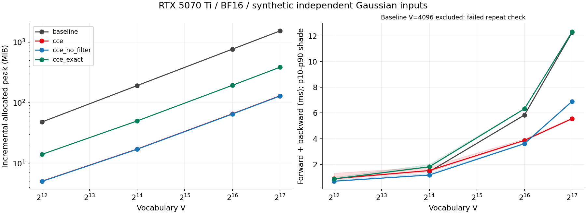
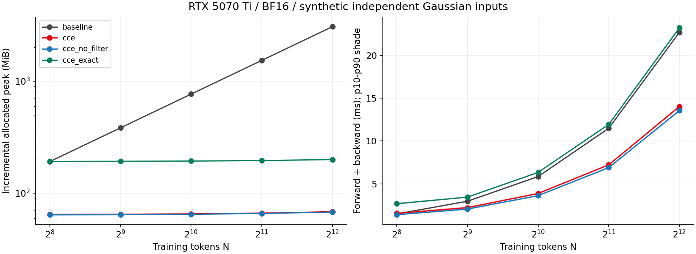
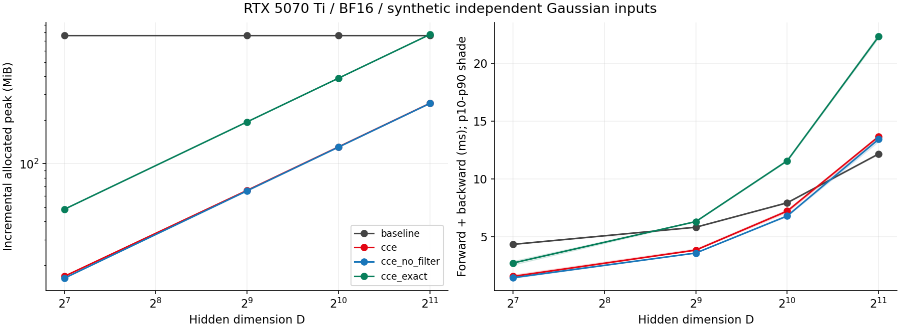
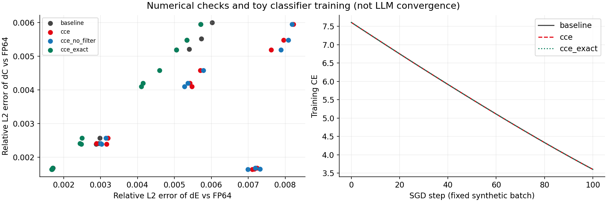
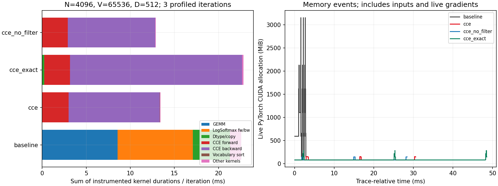
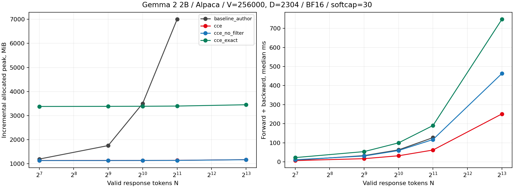

# HW2. Воспроизведение Cut Cross-Entropy


Материалы: [notebook](cce_reproduction.ipynb) · [презентация](presentation.html) · [PDF слайдов](presentation.pdf).

В основном тексте — постановка, пошаговые формулы, среда и интерпретация.
Подробности собраны в приложениях:

- [Приложение A. Gemma 2 2B / Alpaca: подробный протокол](#gemma).
- [Приложение B. Профилирование и повторные timings](#profiling).
- [Приложение C. Реестр доказательств](#evidence).
- [Приложение D. Полные синтетические таблицы](#synthetic-tables).
- [Приложение E. Полные таблицы Gemma](#gemma-tables).
- [Приложение F. Таблицы профилирования](#profile-tables).
- [Приложение G. Текст для выступления](#speaker-notes).


**Статья:** Erik Wijmans, Brody Huval, Alexander Hertzberg, Vladlen Koltun, Philipp Krähenbühl. *Cut Your Losses in Large-Vocabulary Language Models*, ICLR 2025. [PDF v2](sources/paper.pdf), [arXiv](https://arxiv.org/abs/2411.09009), [авторский код](https://github.com/apple-aiml-research/ml-cross-entropy).

**Дата экспериментов:** 9 октября 2026, начало синтетического прогона 13:55 МСК. **Статус:** выполнены classifier-head эксперименты на синтетических данных (этап A, основная часть этого отчёта) и на реальных Gemma 2 2B / Alpaca activations (этап B, §10.7 и [отдельный отчёт](#gemma)). Полное обучение LLM и многокарточный FSDP из статьи не воспроизводились.

## 1. Исследовательский вопрос и границы работы

Нужно ли хранить все logits размером `число обучающих токенов × размер словаря`, если выход loss — всего одно число? Сравниваем память и время двух реализаций loss. Отдельный причинный вклад recomputation во время backward не измеряется.

Статья предлагает CCE: отдельно вычислить score правильного класса, выполнить блочную редукцию log-sum-exp и повторно вычислять блоки в backward. Авторский алгоритм включает gradient filtering и сортировку словаря; наличие этих операций проверено по коду. Авторы сообщают для Gemma 2 2B уменьшение памяти loss с 24 GB до примерно 1 MB, а classifier-head forward+backward — с 28 GB до примерно 1 GB. Это **результаты статьи**, не нашего компьютера; см. abstract и §5.1 [первоисточника](https://arxiv.org/html/2411.09009v2).

Проверяемые вопросы:

1. Loss и градиенты CCE близки к независимому FP64-эталону на тех же входах.
2. Дополнительная память forward у CCE не растёт как полный массив `N×V`; память backward включает обязательные градиенты.
3. Относительная скорость зависит от `N`, `V`, `D` и режима накопления.
4. Выключение filtering и изменение точности накопления дают разные эффекты; их нельзя объединять в одну абляцию.

Работа имеет три уровня: собственная математическая выкладка, проверка авторской реализации и аппаратные измерения. Учебная функция `streaming_loss` нужна для первого уровня. Для GPU-бенчмарка используется именно `cut_cross_entropy`, а не эта функция.

## 2. Обозначения и постановка задачи

Используем расположение осей PyTorch:

| Объект | Размер | Смысл |
|---|---|---|
| `E` | `N×D` | Последний hidden state каждого обучающего токена |
| `C` | `V×D` | Веса выходного линейного классификатора |
| `Z = ECᵀ` | `N×V` | Scores/logits для всех пар токен–класс |
| `y` | `N` | Индекс правильного класса |
| `s` | `N` | Log-sum-exp по словарю |
| `P` | `N×V` | Вероятности softmax; математический объект, не обязательный буфер |

`N` — число позиций, участвующих в prediction, а не обязательно batch size. Для обычного next-token training без padding это `B(T−1)`. У статьи матрицы транспонированы относительно наших обозначений: важно сравнивать смысл осей, а не буквальный порядок размеров.

Маска `m_i=1[y_i≠−100]`, число валидных позиций `M=Σ_i m_i`. В основном бенчмарке все позиции валидны и `M=N`. В проверках корректности есть ignored labels. `M=0` не используется: средний loss по пустому множеству не определён.

## 3. Вывод cross-entropy по шагам

### 3.1. От вероятности правильного класса к loss

Для позиции `i`:

$$z_{ij}=\sum_{k=1}^{D}E_{ik}C_{jk},\qquad p_{ij}=\frac{\exp(z_{ij})}{\sum_{r=1}^{V}\exp(z_{ir})}.$$

С one-hot target отрицательное логарифмическое правдоподобие равно

$$\ell_i=-\sum_{j=1}^{V}\mathbf1[j=y_i]\log p_{ij}=-\log p_{i,y_i}.$$

Подставим определение softmax и раскроем логарифм отношения:

$$\ell_i=-\log\frac{e^{z_{i,y_i}}}{\sum_j e^{z_{ij}}}
=-z_{i,y_i}+\log\sum_j e^{z_{ij}}=s_i-z_{i,y_i}.$$

Итоговая целевая функция:

$$L=\frac1M\sum_{i=1}^{N}m_i\left[s_i-\sum_{k=1}^{D}E_{ik}C_{y_i,k}\right].$$

В forward нужны только `N` нормализаторов и `N` target scores. Из этого ещё **не следует**, что остальные scores можно не вычислять: они входят в нормализатор. Следует другое — их не обязательно хранить одновременно после редукции.

**Знак:** Eq. (4) статьи записана для log-probability. Здесь и в `F.cross_entropy` минимизируется negative log-likelihood, поэтому знак противоположный. На слайде с формулой статьи это различие подписано.

### 3.2. Численный пример

Возьмём scores `[2,1,0]`, правильный класс — первый. Тогда

$$s=2+\log(1+e^{-1}+e^{-2})\approx2.407606,$$
$$\ell=s-2\approx0.407606,\qquad p_y\approx0.665241.$$

Один блок может содержать `[2,1]`, второй — `[0]`. Их log-sum-exp равны примерно `2.313262` и `0`. Объединение через `logaddexp` даёт те же `2.407606`. Полный вектор softmax не нужен для получения скалярного loss.

## 4. Устойчивый и потоковый log-sum-exp

### 4.1. Почему прямой `exp` опасен

Для scores порядка `1000` экспонента переполняется даже в FP64. Вычтем общий максимум `a=max_j z_j`:

$$s=\log\left[e^a\sum_j e^{z_j-a}\right]=a+\log\sum_j e^{z_j-a}.$$

Все аргументы экспонент неположительны. Общий сдвиг logits не меняет вероятности: множитель `e^a` сокращается в числителе и знаменателе.

### 4.2. Объединение двух блоков

Пусть для уже обработанного множества классов `A` храним

$$a_A=\max_{j\in A}z_j,\qquad q_A=\sum_{j\in A}e^{z_j-a_A}.$$

Для нового блока `B` аналогично известны `a_B,q_B`. Тогда

$$a'=\max(a_A,a_B),\qquad
q'=q_Ae^{a_A-a'}+q_Be^{a_B-a'},\qquad s'=a'+\log q'.$$

Это алгебраическое равенство над вещественными числами. В floating point порядок сложения влияет на округление. Для первого непустого блока удобно инициализировать состояние его статистиками, чтобы не вычислять `−∞−(−∞)`.

Эквивалентная форма через уже вычисленные LSE:

$$s_{A\cup B}=\operatorname{logaddexp}(s_A,s_B)
=\max(s_A,s_B)+\log(1+e^{-|s_A-s_B|}).$$

В §2 notebook проверяется именно эта формула, включая неравные размеры блоков и большие logits. Авторское ядро дополнительно решает вопросы размещения данных в SRAM, параллельной редукции и синхронизации. Последовательный Python-цикл не воспроизводит эти аппаратные свойства.

### 4.3. Учебный псевдокод forward

```text
for token block I:
    target[I] = dot(E[I], indexed_rows(C, y[I]))
    lse[I] = -infinity
    for vocabulary block J:
        tile = E[I] @ transpose(C[J])
        local_lse = logsumexp(tile, vocabulary_axis)
        lse[I] = logaddexp(lse[I], local_lse)
        discard tile
return masked_mean(lse - target)
```

Это схема зависимости данных, а не точное расписание GPU. Обычный `C[y]` в PyTorch создаёт дополнительный `N×D` тензор; fused indexed dot может читать нужные строки непосредственно в kernel. Обычный autograd может сохранить промежуточные блоки для backward. Поэтому наличие цикла само по себе не гарантирует низкий peak.

## 5. Полный вывод backward

### 5.1. Производная нормализатора

Обозначим `S_i=Σ_r exp(z_ir)`. По chain rule:

$$\frac{\partial s_i}{\partial z_{ij}}
=\frac1{S_i}\frac{\partial S_i}{\partial z_{ij}}
=\frac{e^{z_{ij}}}{S_i}=p_{ij}.$$

Для target term:

$$\frac{\partial z_{i,y_i}}{\partial z_{ij}}=\mathbf1[j=y_i].$$

Итак,

$$G_{ij}\equiv\frac{\partial L}{\partial z_{ij}}
=\frac{m_i}{M}\left(p_{ij}-\mathbf1[j=y_i]\right).$$

Знак важен: для правильного класса градиент отрицательный, если `p_y<1`; шаг gradient descent увеличивает его score. Для остальных классов градиенты неотрицательны. Для каждой валидной строки `Σ_j G_ij=0`, что согласуется с инвариантностью к общему сдвигу logits.

### 5.2. Производные по embeddings и classifier

Поскольку `z_ij=Σ_k E_ik C_jk`,

$$\frac{\partial L}{\partial E_{ik}}=\sum_j G_{ij}C_{jk},\qquad
\frac{\partial L}{\partial C_{jk}}=\sum_i G_{ij}E_{ik}.$$

В матричной форме:

$$\boxed{\nabla_E L=GC,\qquad\nabla_C L=G^\top E.}$$

Размерности: `(N×V)(V×D)=N×D`, `(V×N)(N×D)=V×D`. Если `E` получено backbone-моделью, `∇E` затем передаётся её autograd; в нашем microbenchmark backbone отсутствует.

### 5.3. Откуда берётся recomputation

Вместо сохранения `P` используем сохранённый `s`:

$$p_{ij}=\exp(z_{ij}-s_i).$$

Backward повторно вычисляет tile `Z_IJ`, восстанавливает `P_IJ`, вычитает target indicator и добавляет вклады

$$\nabla E_I\mathrel{+}=G_{IJ}C_J,\qquad
\nabla C_J\mathrel{+}=G_{IJ}^{\top}E_I.$$

Блок logits живёт недолго. Однако `∇E` и `∇C` должны остаться на выходе backward: это обязательная память, которую CCE не устраняет. Параллельные обновления также требуют выбранного алгоритмом способа согласования записей.

### 5.4. Softcap

В отдельной проверке используется `u=a tanh(z/a)`, `a=30`. Тогда softmax применяется к `u`, а

$$\frac{\partial L}{\partial z_{ij}}=
\frac{m_i}{M}(p_{ij}-\mathbf1[j=y_i])\left[1-\tanh^2(z_{ij}/a)\right].$$

Основная performance-сетка выполняется без softcap. В correctness baseline softcap вычисляется после FP32 upcast; это не копия порядка операций BF16-baseline авторского benchmark. Разница зафиксирована, а независимым эталоном служит FP64.

## 6. Gradient filtering: что именно является приближением

Forward остаётся вычислением полной нормализации. Filtering касается вкладов backward. В используемом исходнике автоматический порог равен `torch.finfo(dtype).eps / 32`; для BF16 это `2⁻¹²≈0.00024414` ([utils.py на выбранном commit](https://github.com/apple-aiml-research/ml-cross-entropy/blob/3de376c106a1916bc5e1b619f9c77c87a461ee1c/cut_cross_entropy/utils.py)).

**Малое число не означает автоматически ноль в BF16.** У BF16 широкий диапазон экспоненты, и небольшие вероятности могут быть представимы. Значимость зависит от относительного масштаба, суммирования и дальнейших матричных произведений. Поэтому filtering проверяем экспериментально; нельзя называть его тождественно точным для любых данных.

Собственная оценка возможной ошибки: если отброшен набор `S_i` положительных probability-вкладов, то

$$\|\Delta\nabla E_i\|\le\frac{m_i}{M}\sum_{j\in S_i}p_{ij}\|C_j\|.$$

Даже при `p_ij<ε` сумма многих слагаемых может быть заметна. Проверка одного порога не заменяет оценку градиентов. В авторском fused backward target correction учитывается отдельно в логике блоков; его нельзя просто отбросить вместе с малыми вероятностями.

Используем четыре основных режима и одну дополнительную проверку:

| Режим | Filtering | Накопление gradients |
|---|---|---|
| baseline | нет | PyTorch linear + CE |
| cce | auto | default upstream |
| cce_no_filter | выключен через `filter_eps=None` | тот же default |
| cce_exact | выключен | FP32 accumulation согласно preset |
| cce_filter_fp32 | auto | FP32 accumulation |

Сравнение настройки filtering при одинаковом accumulation — `cce` против `cce_no_filter`, либо `cce_filter_fp32` против `cce_exact`. Переключение `filter_eps` меняет также вычисление logit averages и сортировку: это сравнение режимов implementation, а не изолированное время проверки порога. Сравнение `cce` и `cce_exact` меняет ещё и accumulation. Название `exact` — имя preset; результат по-прежнему вычисляется в конечной точности и не обязан совпадать с FP64 побитово.

## 7. Оценки памяти и FLOPs

### 7.1. Размеры отдельных объектов

Для BF16 входов, FP32 reduction и int64 targets:

$$M_E=2ND,\quad M_C=2VD,\quad M_y=8N,\quad
M_{Z,\mathrm{BF16}}=2NV,\quad M_{Z,\mathrm{FP32}}=4NV.$$

FP32 LSE занимает `4N` bytes. Default sorting требует статистик порядка `V`; FP32-буфер такого размера занимает `4V` bytes. Градиенты BF16 требуют как минимум `2D(N+V)` bytes. FP32 accumulation добавляет рабочие буферы, поэтому у `cce_exact` существенно больше peak.

**Нельзя получить peak простым сложением всех встречающихся тензоров:** нужно учитывать их времена жизни. Эти формулы описывают размеры объектов. Пик в отчёте измерен отдельно.

Пример нашей основной точки `N=4096,V=65536,D=512`: один BF16-массив logits — 512 MiB, FP32 — 1024 MiB. `E` — 4 MiB, `C` — 64 MiB, минимальные BF16 gradients — 68 MiB. Измеренный дополнительный peak CCE forward+backward — 68.533 MiB: он близок к размеру обязательных градиентов. У baseline extra peak — 3072.001 MiB.

Размер loss не следует путать с footprint classifier head. «Около 1 MB» для loss в статье не означает, что вся модель, её веса, градиенты и optimizer помещаются в 1 MB.

### 7.2. Асимптотика

Дополнительные промежуточные массивы baseline имеют порядок `NV`. Fused CCE устраняет глобальный logits-buffer такого размера; остаются статистики порядка `N+V`, градиенты и служебные буферы. SRAM tile локален для kernel, а не отдельный глобальный `N×V` тензор.

### 7.3. Почему экономия памяти не гарантирует ускорения

Считаем один multiply-add за 2 FLOPs. Основное матричное умножение требует приблизительно `2NVD` FLOPs. Baseline forward+backward содержит forward GEMM и два gradient GEMM — около `6NVD`. Нефильтрованный CCE добавляет повторное вычисление logits — около `8NVD`, без учёта reductions и target term `O(ND)`.

Эта оценка не моделирует fusion, cache, Tensor Cores, padding tiles, синхронизацию и пропуски блоков. Это счёт операций математической схемы, а не измеренные аппаратные FLOPs. Причины различий runtime из этого счёта не устанавливаются. Runtime и длительности kernels приведены отдельно в результатах и profiler-трассах.

## 8. Среда и происхождение кода

| Компонент | Значение |
|---|---|
| GPU | NVIDIA GeForce RTX 5070 Ti, capability 12.0 |
| Доступная устройству VRAM | 17 094 475 776 bytes, примерно 15.92 GiB |
| ОС | Windows, build 26200; полная platform string в JSON |
| Driver | 591.86 |
| Python | 3.11.9 |
| PyTorch / CUDA runtime | 2.11.0+cu128 / 12.8 |
| Triton | triton-windows 3.6.0.post26 |
| Upstream CCE | `3de376c106a1916bc5e1b619f9c77c87a461ee1c` |
| Базовый commit ENN1 / HW1 | `700f5a57aae853c92cc186b46c8737183202e8ec` |
| Seed основной сетки | 42 |

Полная запись — [environment.json](results/main/environment.json). Remote ENN1 проверен: его HEAD совпадал с локальным HW1. Оттуда взята структура отчёта: постановка → формулы → методика → данные → ограничения.

CCE импортируется из отдельного checkout `vendor/ml-cross-entropy`; исходники kernel не изменялись. В §3 notebook адаптированы три обращения к определению версии: Windows-distribution называется `triton-windows`, а upstream ищет `triton`. Для Triton cache выбран ASCII-путь `C:/tmp/enn-hw2-cache`, поскольку путь с кириллицей вызвал ошибку декодирования. Это особенности переноса, а не оптимизация алгоритма.

Репозиторий upstream может изменяться после статьи. Здесь воспроизводится конкретный закреплённый commit, а не утверждается идентичность software stack ICLR 2025. Код и команды позволяют повторить именно этот вариант.

## 9. Протокол эксперимента

### 9.1. Входные данные

`E` и `C` генерируются независимо из нормального распределения в BF16 и масштабируются на `D⁻¹/⁴`. Тогда произведение масштаба двух множителей даёт `D⁻¹/²`, а дисперсия суммы `D` произведений остаётся порядка единицы. Targets равномерные случайные.

Это воспроизводимые синтетические данные без загрузки модели. В отличие от upstream `randn` generator, здесь не присваиваются одинаковые строки `E` и `C`. Такие данные не имеют распределения logits обученной LLM. В диагностике дополнительно умножаем `E` на 4 для более контрастных logits.

### 9.2. Корректность

Три seed: 42, 43, 44. Четыре постановки на seed:

| N | V | D | Множитель E | Softcap | Ignore |
|---:|---:|---:|---:|---:|---|
| 37 | 257 | 64 | 1 | нет | каждая 7-я позиция |
| 128 | 4096 | 128 | 1 | нет | нет |
| 128 | 4096 | 128 | 4 | нет | нет |
| 67 | 1025 | 128 | 4 | 30 | каждая 7-я позиция |

FP64-эталон строится из **тех же уже округлённых BF16 входов**, приведённых к double. Это исключает различие входных данных как причину ошибки. Эталон использует обычный matmul, softcap при необходимости и `F.cross_entropy`, затем autograd. TF32 отключён.

Метрики: абсолютное отклонение loss, максимальная покомпонентная ошибка и относительная L2-ошибка обоих градиентов:

$$\operatorname{relL2}(g,g_*)=\frac{\|g-g_*\|_2}{\max(\|g_*\|_2,10^{-30})}.$$

Допуски в коде до измерений: `abs Δloss < 0.05`, обе `relL2 < 0.05`. Они являются практическим критерием mixed-precision sanity check; в выводах используем фактически наблюдавшиеся ошибки, которые значительно меньше порога. Всего 12 задач × 5 методов = 60 проверок. Отдельно выполнены 5 CPU-тестов формул, включая finite-difference gradcheck.

### 9.3. Сетка производительности

11 уникальных shapes, четыре метода, два режима = 88 строк:

- Sweep `V`: `4096,16384,65536,131072` при `N=1024,D=512`.
- Sweep `N`: `256,512,1024,2048,4096` при `V=65536,D=512`.
- Sweep `D`: `128,512,1024,2048` при `N=1024,V=65536`.

Общая центральная точка не измеряется повторно в каждом sweep. Во всех performance-точках BF16, mean reduction, no softcap, все labels валидны.

### 9.4. Измерение времени

Каждый метод прогревается пятью выполнениями, включая backward для режима `fw_bw`. Компиляция Triton происходит до timed samples. Затем собираются 3 серии по 10 измерений CUDA events, между образцами ожидается end event. Записываются все 30 значений, median, p10 и p90. p10–p90 — разброс повторений, не доверительный интервал.

Входы созданы заранее. Градиенты очищаются через `grad=None` до start event. Для `fw` включён autograd, как при training; это не inference. Для `fw_bw` timed interval содержит forward и backward. Порядок четырёх методов разворачивается через одну shape. CUDA events измеряют интервал на GPU timeline и могут включать ожидание подачи kernels с CPU; это не сумма одних лишь длительностей kernels из profiler.

Код в [notebook](cce_reproduction.ipynb), §7, измеряет чистый backward на свежем графе, построенном до start event: 5 warmup + 30 samples. Нельзя считать backward просто разностью медиан `T_fw_bw−T_fw`: графы, порядок и шум могут различаться.

### 9.5. Измерение памяти

После warmup удаляется предыдущий loss, градиенты освобождаются, выполняются synchronize и garbage collection. Фиксируется `base=memory_allocated()`, затем `reset_peak_memory_stats()`, один проход и `peak=max_memory_allocated()`.

Отчётная дополнительная память `extra=peak−base`. В `fw_bw` она включает gradients; в base находятся живые входы и другие постоянные allocations. Сохраняются **обе** величины — абсолютный peak и extra. Это allocated memory PyTorch, не reserved cache и не весь расход устройства из `nvidia-smi`. Чужие процессы в эти числа не входят, но способны повлиять на скорость.

OOM обрабатывается отдельным статусом без подстановки нулевого времени. В выполненной сетке OOM не было. Граница вместимости всей LLM не измерялась.

## 10. Результаты и интерпретация

### 10.1. Корректность

Все 60 проверок прошли. Максимумы по 12 задачам для каждого метода:

| Метод | abs Δloss | relL2 ∇E | relL2 ∇C |
|---|---:|---:|---:|
| baseline | 0.002237 | 0.006026 | 0.006003 |
| CCE default | 0.002237 | 0.008219 | 0.005951 |
| CCE без filtering | 0.002237 | 0.008187 | 0.005951 |
| CCE exact | 0.002237 | 0.005713 | 0.005951 |

Максимальная наблюдавшаяся относительная L2-ошибка CCE default по embeddings — **0.822%**, по classifier — **0.595%**. Для baseline эти максимумы — **0.603%** и **0.600%**. Для no-filter и exact максимумы ошибки `∇E` — **0.819%** и **0.571%**. Это максимумы по данной проверочной сетке; каждый case сохранён в JSON.

Эти проверки не доказывают равенство для любых shapes и распределений. Проверки большого performance-grid с FP64 не проводились; mixed-precision sanity suite отделена от нагрузочной сетки.

### 10.2. Показательная большая точка

`N=4096,V=65536,D=512`, BF16, forward+backward:

| Метод | Extra peak, MiB | Полный allocated peak, MiB | Median, ms |
|---|---:|---:|---:|
| baseline | 3072.001 | 3156.282 | 22.710 |
| CCE default | 68.533 | 152.814 | 14.034 |
| CCE без filtering | 68.033 | 152.314 | 13.562 |
| CCE exact | 200.033 | 284.314 | 23.227 |

Для default CCE дополнительный peak меньше в **44.83 раза**, полный allocated peak — примерно в **20.65 раза**. Скорость выше в **1.62 раза**. Эти три отношения описывают разные величины, поэтому на слайдах они подписаны отдельно.

В forward этой же точки extra peak меняется с **2048.001 MiB** у baseline до **0.282 MiB** у CCE. В backward появляются обязательные gradients, поэтому сравнение «всего training step с почти нулём» было бы неверным.

### 10.3. Масштабирование







На измеренном sweep `N` дополнительная память CCE forward+backward растёт слабее baseline. Для фиксированных `V,D` размер `∇C=2VD` не зависит от `N`, а размер `∇E=2ND` растёт линейно. Это размеры выходных градиентов; полный peak зафиксирован измерением, а не получен из этой формулы.

При `N=1024,V=65536,D=2048` default CCE занимает **13.686 ms**, baseline — **12.183 ms**: CCE примерно на **12.3% медленнее**, хотя extra peak снижается с 768.001 до 260.568 MiB. Для exact peak достигает 776.068 MiB и в этой точке превышает baseline. В profiler-трассе exact есть allocation 512 MiB; у default крупнейший allocation в этой точке — 256 MiB. Обобщение на неизмеренные отношения `N/D` не делается.

Первоначальный timing baseline **4.228 ms** при `N=1024,V=4096,D=512` не воспроизвёлся. В трёх новых trials median-of-medians равна **0.315 ms** для повторов без очистки L2 и **0.272 ms** для `do_bench` с очисткой L2. Поэтому первоначальная точка исключена из выводов о скорости. Исходный JSON сохранён; на графике timing отмечено, что точка исключена. Причина расхождения не установлена. Полные повторные измерения: [Приложение F. Таблицы профилирования](#profile-tables).

### 10.4. Абляция filtering и отдельный backward

На `N=512,V=32768,D=256`, scale=1:

| Метод | Forward+backward, ms | Только backward, ms |
|---|---:|---:|
| baseline | 1.218 | 0.781 |
| CCE default | 1.087 | 0.754 |
| CCE без filtering | 0.835 | 0.579 |
| CCE exact | 1.348 | 1.063 |
| CCE filtering + FP32 | 1.558 | 1.268 |

В этой серии no-filter быстрее default, а exact быстрее filtering+FP32. При scale=4 направление сохраняется. В отдельных profiler-трассах default есть kernels сортировки словаря, в no-filter они отсутствуют. Это два наблюдения; причинный вклад sorting и block checks в разность общего runtime отдельно не установлен. Доля пропущенных блоков не измерялась.

Вывод ограничен приведёнными синтетическими входами и настройками. Результаты на выходах обученной модели оформляются отдельной серией.

### 10.5. Небольшая проверка обучения



Обучается только classifier `C`, embeddings фиксированы: `N=256,V=1024,D=128`, seed=123, 100 шагов SGD, learning rate=1, один фиксированный случайный batch, параметры BF16. После каждого шага происходит BF16 rounding. Это проверка работоспособности backward в цепочке optimizer updates, а не language modeling.

| Метод | Loss в начале | Loss после 100 шагов |
|---|---:|---:|
| baseline | 7.609138 | 3.600448 |
| CCE default | 7.609138 | 3.600549 |
| CCE exact | 7.609138 | 3.600448 |

Кривые близки, но такой результат не проверяет validation perplexity, качество генерации, generalization или долговременную устойчивость pretraining.

### 10.6. Проверка выводов profiler-трассами

Записаны 12 трасс: три shapes × четыре метода, по три iterations после warmup. Они содержат CUDA kernels и memory events. На `N=4096,V=65536,D=512` видны baseline allocations по 1 GiB, тогда как у CCE default крупнейший отдельный allocation — 64 MiB. Kernels сортировки присутствуют в default и отсутствуют в no-filter. Отдельный причинный вклад sorting в общий runtime и число пропущенных tiles не измерены.

Дополнительно выполнены 54 записи повторного benchmark с двумя протоколами: CUDA events без явной очистки L2 и `triton.testing.do_bench`. Эти протоколы различаются также синхронизацией; разница не приписывается одному лишь кэшу. Подробный протокол и источники чисел — [Приложение B. Профилирование и повторные timings](#profiling), таблицы — [Приложение F. Таблицы профилирования](#profile-tables).



Сопоставление основных утверждений с их основаниями — [Приложение C. Реестр доказательств](#evidence). Неустановленные причины различий runtime не включаются в выводы.

### 10.7. Этап B: Gemma 2 2B / Alpaca

Дополнительно извлечены 8192 prediction positions из 52 примеров Alpaca с настоящими весами `google/gemma-2-2b-it`. Revisions и input hashes зафиксированы. D=2304, V=256000, BF16, softcap=30. Это отдельный эксперимент; backbone inference выполнен до измерений, обучения backbone не было.

На N=1024, forward+backward, авторский BF16-softcap baseline: **3500.001 MiB / 62.751 ms**; CCE default: **1132.734 MiB / 31.877 ms**. Здесь extra peak меньше в **3.09×**, время — в **1.97×**. No-filter занимает **59.362 ms**. На этой shape default быстрее no-filter; отдельная причина разницы не установлена.

Для N=8192 CCE default: forward extra peak **1.040 MiB**, forward+backward **1164.269 MiB / 251.254 ms**. Baseline при N=8192 **не запускался по memory guard**; это не измеренный OOM. На этой N отношение baseline/CCE не заявляется.

Пять checks loss/gradients на первых 32 позициях полного словаря прошли заданные допуски относительно **FP32**, TF32 off. Ошибка CCE default: relL2 ∇E **0.704%**, ∇C **0.522%**. Эти проверки не смешиваются с 60 FP64 checks этапа A.

Сохранены **38 измерений**, две строки с planned skip и **3 дополнительные profiler-трассы**. Протокол, все отличия от статьи, таблицы и ограничения: [Приложение A. Gemma 2 2B / Alpaca: подробный протокол](#gemma), [Приложение E. Полные таблицы Gemma](#gemma-tables).



## 11. Что проверено и что осталось за пределами

| Утверждение | Итог локальной проверки |
|---|---|
| Loss и оба gradients численно согласованы | Подтверждено на 12 задачах и 5 режимах в заданных допусках |
| Устранение большого logits-buffer уменьшает память | Подтверждено измерениями scaling |
| CCE быстрее baseline при любой форме | Опровергнуто нашей сеткой |
| Filtering всегда даёт ускорение | Не подтверждено на синтетических данных |
| Loss и gradients совпадают с FP64 побитово | Нет: сохранены ненулевые отклонения |
| Полная сходимость LLM как в статье | Не проверялась; toy training недостаточен |
| Отношение 24 GB → 1 MB в исходном setup статьи | Не воспроизведено: локальный baseline при N8192 не запускался |
| Максимальный batch, FSDP, энергия | Не исследовались |

Ограничения: одна потребительская GPU, Windows/Triton port, новая относительно статьи версия PyTorch, 30 samples внутри одного запуска, без независимых повторов всего grid и без стабилизации частоты. Этап A использует синтетические входы; этап B — один зафиксированный набор Gemma/Alpaca activations. `torch.compile`, Torch Tune, Liger и полный набор baseline статьи в наше сравнение не включены. Это локальные classifier-head измерения, а не полная реплика всех таблиц статьи.

## 12. Инструкция воспроизведения и артефакты

Весь исполняемый код работы собран в [cce_reproduction.ipynb](cce_reproduction.ipynb).
Установка и режимы запуска описаны в [README.md](README.md). Дополнительные локальные `.py`
для запуска notebook не нужны. HW2 расположен рядом с `hw1/` в одном репозитории.

| Артефакт | Содержимое |
|---|---|
| `cce_reproduction.ipynb` | Markdown-пояснения, формулы, CPU-проверки, CUDA benchmarks, profiler, Gemma preprocessing и анализ |
| `REPORT.md` | Этот отчёт: выкладки, протокол, таблицы, доказательства и текст доклада |
| `presentation.html`, `presentation.pdf` | 12 основных слайдов + 5 приложений |
| `results/` | Исходные timing samples, correctness, environments и 15 gzip-трасс |
| `figures/` | Графики для отчёта и презентации |
| `sources/paper.pdf` | Статья arXiv v2 |

**Run All по умолчанию** заново выполняет CPU-проверки формул, строит таблицы и графики
из сохранённых данных и сверяет summaries с сырыми трассами. Этот режим не объявляется
повторным GPU-измерением. Для новых экспериментов в первой code cell включаются
`RUN_GPU_SMOKE`, `RUN_SYNTHETIC`, `RUN_DIAGNOSTICS`, `RUN_CACHE`, `RUN_PROFILER` или `RUN_REAL`.
Новые данные записываются в отдельный `results/notebook_runs/<UTC timestamp>/`.
Выводы этого отчёта относятся к исходным сохранённым сериям.

Исторические environment-файлы сохранены без изменения: их `source_sha256` относятся
к рабочим скриптам, которыми получены исходные измерения. Эти локальные скрипты теперь
исключены из Git; публичный код перенесён в notebook. Их старые SHA256 не выдаются за
хеш нового notebook. Новые запуски записывают `notebook_code_sha256` для всех code cells.
При переносе сохранены вычисления и протоколы измерения; загрузка Alpaca теперь явно
закреплена на revision из исходного provenance, а не разрешает текущую версию dataset.

## 13. Источники

1. [Wijmans et al., arXiv:2411.09009v2](https://arxiv.org/html/2411.09009v2), версия 10.03.2025: постановка и авторский алгоритм; локальная копия PDF в `sources/`.
2. [Apple CCE, закреплённый commit](https://github.com/apple-aiml-research/ml-cross-entropy/tree/3de376c106a1916bc5e1b619f9c77c87a461ee1c): выполненные kernels, presets и API.
3. [Triton for Windows](https://github.com/triton-lang/triton-windows): используемый перенос Triton.
4. [ENN1 / HW1](https://github.com/FD-AX/ENN1/tree/700f5a57aae853c92cc186b46c8737183202e8ec/hw1): референс структуры отчёта.

Формулы с пошаговым выводом, численный пример, критерии проверки, синтетический протокол, графики и интерпретация ограничений подготовлены для этой работы. Они не выдаются за дополнительные эксперименты авторов статьи.


<a id="gemma"></a>

## Приложение A. Gemma 2 2B / Alpaca: подробный протокол

**Выполнено 9 октября 2026.** Это отдельный classifier-head эксперимент на выходах pretrained модели. Backbone не обучался. Его inference использован только для подготовки embeddings; время и память backbone не входят в benchmark.

### 1. Происхождение входов

| Объект | Зафиксированное значение |
|---|---|
| Модель | `google/gemma-2-2b-it` |
| Revision модели | `299a8560bedf22ed1c72a8a11e7dce4a7f9f51f8` |
| Датасет | `yahma/alpaca-cleaned` |
| Revision датасета | `12567cabf869d7c92e573c7c783905fc160e9639` |
| Число использованных примеров | 52 |
| Число сохранённых валидных prediction positions | 8192 |
| Vocabulary / hidden dimension | 256000 / 2304 |
| Dtype E, C | BF16 |
| Final logit softcap | 30 |
| Transformers | 5.8.1 |
| Hugging Face Hub | 1.15.0 |

Использованы [модель Google](https://huggingface.co/google/gemma-2-2b-it/tree/299a8560bedf22ed1c72a8a11e7dce4a7f9f51f8) и [Alpaca cleaned](https://huggingface.co/datasets/yahma/alpaca-cleaned/tree/12567cabf869d7c92e573c7c783905fc160e9639). Версии CUDA/PyTorch/Triton и GPU записаны в [environment.json](results/gemma2/environment.json).

Код подготовки входов в §10 notebook воспроизводит текст prompt и подход к masking из `training/train.py` авторского CCE-репозитория, commit `3de376c`. Для Gemma system prompt отсутствует. Используется chat template из закреплённого tokenizer. Позиции до начала assistant response имеют label `−100`; последующие template tokens, как и в upstream preprocessing, остаются в labels. Поэтому «валидные позиции» включают также завершающие tokens шаблона.

Порядок примеров перемешан `random.Random(42)`. Каждый пример отдельно обрезан до 512 input tokens. Извлекается `decoder(...,use_cache=False).last_hidden_state`, сдвиг: `hidden[:-1]` предсказывает `labels[1:]`. После удаления ignored labels собираются первые 8192 позиции. Ни один из рассмотренных примеров не был пропущен. `C` — `model.get_output_embeddings().weight`, без квантования и без обучения. Attention — `eager`, модель в `eval()`, extraction под `no_grad()`.

**Отличия от протокола авторов:** собственный shuffle seed и список примеров, последовательная обработка по одному примеру, Transformers 5.8.1, RTX 5070 Ti и Windows. Поэтому входы настоящие и модель та же, но sample/order/software/hardware не объявляются идентичными статье.

Список example indices и SHA256 датасета и файла E/C/y сохранены в `environment.json → data_provenance`. Веса и подготовленные тензоры находятся в игнорируемых Git каталогах `.models/` и `.data/`; в сдаваемых результатах находятся provenance, код и измерения.

### 2. Проверка арифметики

Использованы первые **32** извлечённые позиции, **все 256000 классов** и полный classifier. Независимый reference: те же BF16 E/C приведены к FP32, обычный matmul, FP32 softcap и `F.cross_entropy`. TF32 выключен. Reference gradients сохранены на CPU, ошибки считаются по всем элементам блоками, с FP64-аккумуляцией норм.

Это **FP32 reference**, не FP64 reference предыдущей синтетической серии. Его loss равен **2.123993874**.

| Метод | abs Δloss | relL2 ∇E | relL2 ∇C |
|---|---:|---:|---:|
| Авторский BF16 baseline | 0.010700 | 0.015347 | 0.013987 |
| CCE default | 0.006468 | 0.007038 | 0.005223 |
| CCE no-filter | 0.006469 | 0.008390 | 0.005213 |
| CCE exact | 0.006468 | 0.006478 | 0.005213 |
| BF16 matmul + FP32 softcap baseline | 0.006424 | 0.006482 | 0.005219 |

Все пять checks прошли объявленные в коде допуски `abs Δloss<0.05`, `relL2<0.05`. Публикуются сами ошибки; прохождение этих допусков не является проверкой качества обучения. Для CCE default ошибка `∇E` в этой задаче — **0.704%**, `∇C` — **0.522%**. Для остальных N FP32 gradient comparison не выполнялся.

**Два baseline не смешиваются:** `baseline_author` использует порядок авторского benchmark: BF16 matmul → BF16 `tanh(z/30)*30` → FP32 CE. Последняя строка таблицы переносит softcap в FP32 и используется только в correctness. В performance-сетке baseline — именно `baseline_author`.

### 3. Протокол времени и памяти

Из одного сохранённого массива берутся префиксы N=`128,512,1024,2048,8192`. D и V постоянны. Для каждого метода и N — training forward и forward+backward, 5 warmup, 30 samples CUDA events. Компиляция происходит до samples. Градиенты очищаются до start event. Измерения без специальной очистки L2, synchronize после каждого sample.

Peak измерен отдельным проходом после warmup. `extra=peak−base`, как в основной серии. Входные E/C/y созданы до измерения. В `fw_bw` extra включает gradients. Сохраняются base, full peak и extra, все timing samples и квантили.

Всего в таблице **40 запланированных строк**: **38 реально измерены**, **2 заранее пропущены**. Для baseline при N=8192 применяется memory guard: `16NV+4VD+4ND > 0.8×device_memory`. Это заранее заданная оценка бюджета, не доказанный peak и не наблюдённый OOM. В этих строках статус `not_run_memory_guard`; времени и памяти нет. Отношение baseline/CCE при N=8192 не вычисляется.

### 4. Результат при N=1024

V=256000, D=2304, BF16, softcap=30, forward+backward:

| Метод | Extra peak, MiB | Полный allocated peak, MiB | Median, ms |
|---|---:|---:|---:|
| baseline_author | 3500.001 | 4646.759 | 62.751 |
| CCE default | 1132.734 | 2279.492 | 31.877 |
| CCE no-filter | 1130.781 | 2277.539 | 59.362 |
| CCE exact | 3385.281 | 4532.039 | 99.440 |

На этой точке default CCE имеет **3.09× меньший extra peak** и **1.97× меньшее время** относительно baseline. No-filter занимает **1.86× больше времени**, чем default. Это сравнение режимов implementation на данной shape, а не выделенная причинная оценка одного механизма filtering.


Полная таблица — [Приложение E. Полные таблицы Gemma](#gemma-tables). При N=2048 baseline измерен: **7000.001 MiB / 127.066 ms**, CCE default — **1136.239 MiB / 61.982 ms**.

### 5. N=8192: измерен только CCE и его варианты

Для CCE default:

- Forward: extra peak **1.040 MiB**, median **107.485 ms**.
- Forward+backward: extra peak **1164.269 MiB**, median **251.254 ms**.
- No-filter forward+backward: **462.971 ms**.
- Exact forward+backward: **747.201 ms**.

Baseline при N=8192 **не запускался**. Здесь не заявляется воспроизведение отношения памяти из статьи и не подставляются её числа вместо локального baseline. Совпадение названия модели и размеров не делает эксперимент идентичным статье.

### 6. Профилирование реальных activations

Для N=1024 записаны три дополнительные трассы: baseline_author, CCE default, CCE no-filter. Каждая содержит три iterations после warmup, CPU/CUDA и allocation events. Traces: `results/gemma2/*.trace.json.gz`; разобранные события: `*.profile.json`.

| Величина под profiler | CCE default | CCE no-filter |
|---|---:|---:|
| Forward kernel, ms / iteration | 13.415 | 13.294 |
| Backward kernel, ms / iteration | 16.704 | 44.390 |
| Все kernel launches / iteration | 26 | 17 |

В этой трассе backward kernel default короче no-filter. Число пропущенных tiles и отдельные durations threshold checks, sorting и locks внутри алгоритма не измерены. Поэтому разница не объясняется утверждением о конкретной доле sparsity.

Крупнейший allocation event в трёх трассах — **1126 MiB**. Математический размер BF16 classifier gradient — **1125 MiB** (`2VD`); эти величины не отождествляются. Пик baseline выше размера одного allocation, что видно в отдельном измерении `max_memory_allocated`.

### 7. Допустимые выводы

1. На извлечённых Gemma/Alpaca входах пять проверенных режимов прошли указанные numerical tolerances на N=32; полные errors сохранены.
2. На измеренной N=1024 default CCE использует меньше extra memory и времени, чем авторский baseline.
3. На тех же входах и shape default CCE быстрее no-filter; под profiler его backward kernel имеет меньшую duration.
4. В другой, синтетической серии no-filter быстрее default. Серии различаются также shapes и softcap, поэтому это не изолированное доказательство влияния распределения данных.
5. Full-model training, validation perplexity, качество генерации и долговременная сходимость не проверены.

### 8. Воспроизведение

После установки зависимостей из README включить в notebook `DOWNLOAD_REAL=True`
и `PREPARE_REAL=True` для первоначальной подготовки, затем `RUN_REAL=True` для измерений.
Если `gemma_activations.pt` уже существует, повторная подготовка не нужна: включить только
`RUN_REAL`. Подготовка отказывается перезаписывать существующий файл.

Нужен существующий доступ Hugging Face к Gemma, около 5.3 GB для весов и 1.2 GB для E/C/y.
Модель и dataset скачиваются по закреплённым revisions. Xet отключён; используются
обычные HTTP-загрузки. Токен доступа в notebook не хранится.


<a id="profiling"></a>

## Приложение B. Профилирование и повторные timings

Дополнение к [REPORT.md](REPORT.md). Семинар `triton_seminar.ipynb` использован как контекст методики: блоки Triton, прогрев до измерения, CUDA events, `triton.testing.do_bench`. Его ячейки не запускались целиком и не использовались как инструкции на установку или публикацию.

### Что выполнено

§9 notebook: 3 shapes × 4 метода. После восьми warmup записаны три forward+backward итерации с `torch.profiler`: CPU, CUDA, shapes, allocations, stacks, FLOPs для поддерживаемых PyTorch-операций. Каждый метод имеет собственную `.trace.json.gz`, `.summary.json` и таблицу operators.

| Точка | N | V | D | Зачем включена |
|---|---:|---:|---:|---|
| small | 1024 | 4096 | 512 | Перепроверка первоначального малого timing |
| large | 4096 | 65536 | 512 | Точка с большим различием extra peak |
| wide | 1024 | 65536 | 2048 | Точка, в которой CCE default медленнее baseline |

Проверено наличие CUDA kernels в каждой из 12 трасс. CPU events не выдаются за GPU durations. Суммы CUDA durations делятся на три итерации. Числа под profiler не подставляются в таблицы обычного runtime.

### 1. Какие allocations видны

В точке large:

- Baseline: первый allocation logits — **536 870 912 bytes = 512 MiB**; есть allocations **1 073 741 824 bytes = 1024 MiB**.
- CCE default: крупнейший отдельный allocation — **67 108 864 bytes = 64 MiB**; также есть **4 194 304 bytes = 4 MiB**.
- Для BF16 gradients размеры по формуле: `∇C:2×65536×512=64 MiB`, `∇E:2×4096×512=4 MiB`.
- CCE exact: крупнейший allocation — **128 MiB**, то есть размер `V×D` FP32 buffer.

Временные ряды `Total Allocated` содержатся в `[memory]` events. Размер отдельного allocation — не peak; peak по основному измерению приведён в `measurements.json`.

Источник: `results/profiles/large_*.summary.json`, поля `cuda_allocations`. Соответствие размеров градиентам — арифметический расчёт; назначения буферов также проверяются по allocations `dE/dC` и FP32 buffers в `cut_cross_entropy/cce_backward.py` закреплённого upstream.

### 2. Какие kernels видны

Для large среднее число kernel launches на одну iteration:

| Метод | Launches | Сумма kernel durations, ms |
|---|---:|---:|
| baseline | 11 | 22.582 |
| cce | 26 | 13.411 |
| cce_no_filter | 17 | 12.882 |
| cce_exact | 19 | 22.827 |

CCE имеет больше launches в этих трассах, но меньшую сумму длительностей в сравнении с baseline. Следовательно, число launches само по себе не является нашим критерием скорости.

В baseline видны GEMM, LogSoftmax forward/backward и dtype-copy kernels. В CCE видны `_cce_lse_forward_kernel`, `_cce_backward_kernel` и служебные kernels. В default присутствуют `DeviceRadixSort...`; в no-filter этих kernels нет.

Для large default длительность CCE forward kernel в среднем **2.988 ms**, backward kernel — **10.327 ms**. Для no-filter — **2.918 ms** и **9.901 ms** соответственно. Это измерения под profiler, а не отдельная оценка времени recomputation внутри backward.

**Что из трасс не следует:** какая доля gradient tiles пропущена, сколько времени внутри kernel заняли locks, сколько байтов прочитано из DRAM, какова доля cache hits. Эти величины не измерены и не используются для объяснения ускорений.


### 3. Metadata kernel launch

Трасса large CCE backward содержит `grid=[16384,1,1]`, `block=[128,1,1]`, 255 registers/thread и 49 152 bytes shared memory. Эти значения сохранены в `analysis.json` в `kernel_metadata`.

Поле profiler `est. achieved occupancy %` — оценка инструмента. Оно не используется как измеренный аппаратным счётчиком показатель и не включено в наши выводы. Аналогично `with_flops=True` не даёт полного счёта FLOPs произвольного Triton kernel; нельзя сравнивать такой частичный счёт с PyTorch GEMM как полные FLOPs двух методов.

Nsight Systems / Nsight Compute в проверенном PATH не обнаружены. Аппаратные counters DRAM throughput, occupancy и stall reasons в этой работе не измерялись.

### 4. Повторные timings и методика семинара

Код §8 notebook измеряет те же три shapes, методы baseline/CCE/no-filter, два протокола и три trials с перемешиванием порядка (seed=42): **54 записи**.

1. `repeat_cache`: 10 warmup, 30 samples CUDA events, synchronize после каждого sample; специальной очистки L2 нет.
2. `l2_flush`: после 10 явных warmup — локальная реализация `triton.testing.do_bench(warmup=25,rep=100,return_mode='all')`. `25` и `100` здесь — миллисекунды бюджета, не число iterations. Triton очищает cache перед каждым measured call; число samples определяется реализацией.

Проверен исходник `do_bench` из установленного Triton 3.6.0: очистка cache находится **до start event**. Внутри обоих measured call gradients сбрасываются через `grad=None`. Все samples сохранены.

**Протоколы различаются не только cache:** `do_bench` не делает synchronize после каждого measured call, а синхронизируется после серии. Поэтому разницу между двумя столбцами нельзя причинно приписывать L2. Отдельная чистая абляция L2 не проводилась.

Median-of-medians трёх trials для small:

| Метод | repeat_cache, ms | l2_flush, ms |
|---|---:|---:|
| baseline | 0.315 | 0.272 |
| cce | 0.937 | 0.857 |
| cce_no_filter | 0.722 | 0.646 |

Первоначальная small baseline **4.228 ms** не воспроизведена. Её исключаем из выводов о скорости и timing-кривой; исходный JSON и полная таблица сохранены с пометкой. **Причина расхождения неизвестна.** Новые измерения показывают, что на этой small shape baseline быстрее CCE default в обоих протоколах.

Для wide направление первоначального сравнения сохранилось: repeat_cache baseline **12.214 ms**, CCE **13.903 ms**; l2_flush baseline **12.116 ms**, CCE **13.883 ms**.

Полные числа и таблицы — [Приложение F. Таблицы профилирования](#profile-tables). Для каждого вывода указан конкретный shape, метод и протокол; переноса на другие GPU/распределения нет.

### Запуск и просмотр

В первой code cell notebook включить `RUN_PROFILER=True` и/или `RUN_CACHE=True`.
Таблицы анализа явно читают сохранённые серии; новые запуски записываются в отдельный
каталог `results/notebook_runs/`. Gzip-трассы можно распаковать и открыть локально
в просмотрщике Chrome Trace/Perfetto.

Источники API: [PyTorch profiler](https://docs.pytorch.org/docs/2.11/profiler.html), [Triton do_bench](https://triton-lang.org/main/python-api/generated/triton.testing.do_bench.html). Поведение конкретной установленной версии проверялось по её локальному исходнику.


<a id="evidence"></a>

## Приложение C. Реестр доказательств

Правило отчёта: число сопровождается shape/режимом и сырыми данными; описание implementation — ссылкой на конкретный исходник; математическое равенство — выводом. Неустановленные причины не заменяются предположениями.

| Утверждение | Основание | Граница |
|---|---|---|
| CE = LSE − target logit; dE=GC, dC=GᵀE | REPORT §§3–5; notebook §2; 5 CPU tests, включая gradcheck | Математическая формула; не обещание побитового равенства floating point |
| 60/60 checks прошли | `results/main/correctness.json`, поле `passed` | 12 заданных задач × 5 методов; допуски из notebook §4 |
| CCE default max relative L2 dE = 0.0082192 | тот же JSON, method=cce, максимум `e.relative_l2` | FP64 reference на тех же BF16 inputs; не любой dataset |
| Extra peak 3072.001 → 68.533 MiB | `results/main/measurements.json`, N4096/V65536/D512/kind=fw_bw | PyTorch allocated extra, не вся VRAM и не полный LLM |
| Runtime 22.710 → 14.034 ms | те же две строки, `median_ms` | 30 CUDA-event samples, эта GPU и этот протокол |
| CCE default медленнее baseline при D2048 | main JSON N1024/V65536/D2048; повторено в `cache_benchmark/measurements.json` | Две методики, конкретная shape; причина не установлена |
| Initial small baseline timing ненадёжен для выводов | main 4.228 ms; 3 новых trials в cache_benchmark: около 0.3 ms | Причина расхождения не установлена, старое число исключено из выводов |
| Baseline выделяет отдельный 1 GiB buffer | `profiles/large_baseline.summary.json`, `cuda_allocations.Bytes` | Это allocation, не общий peak |
| CCE default largest allocation 64 MiB | `profiles/large_cce.summary.json` | N4096/V65536/D512, эта implementation |
| Default CCE имеет sorting kernels, no-filter — нет | `profiles/large_cce*.summary.json`, `kernels.name`; upstream `cce.py` | Не доказывает, что sorting объясняет всю разницу runtime |
| Exact включает FP32 accumulation | upstream `cce_utils.py`, preset `cce_exact` | Имя exact не означает отсутствие округления |
| Автоматический BF16 filter epsilon = 2⁻¹² | upstream `utils.py`, `torch.finfo(dtype).eps/32` | Это порог алгоритма, а не минимальное представимое BF16 число |
| Toy loss после 100 updates близок | `results/main/toy_training.json` | Только фиксированный batch и classifier; никаких выводов о LLM convergence |
| Авторские числа 24 GB → ~1 MB | arXiv:2411.09009v2, abstract | Результат авторов, нами в том setup не измерен |
| Gemma N1024: 3500.001 → 1132.734 MiB, 62.751 → 31.877 ms | `results/gemma2/measurements.json`, V256000/D2304/softcap30/kind=fw_bw | Classifier head; baseline_author; 30 samples, без backbone |
| Gemma N8192: CCE forward extra 1.040 MiB | тот же JSON, method=cce,kind=fw | Baseline здесь не запускался; отношение baseline/CCE не вычисляется |
| Gemma checks 5/5; default relL2 dE=0.007038 | `results/gemma2/correctness.json` | N32, полный V; reference FP32, не FP64 |
| На Gemma N1024 default backward kernel короче no-filter | `results/gemma2/{cce,cce_no_filter}.profile.json` | Duration под profiler; skipped tiles не подсчитывались |

Upstream во всех ссылках: commit `3de376c106a1916bc5e1b619f9c77c87a461ee1c`. Основные executed-source hashes сохранены в environment.json. Новые запуски notebook сохраняют собственные environment records и хеш code cells.

### Удалённые объяснения

- Причина первоначального timing через GPU clocks, WDDM или kernel selection: не установлена.
- Объяснение проигрыша filtering через долю пропущенных tiles: доля не измерена.
- Утверждение, что вся разность timing протоколов вызвана L2: протоколы отличаются также синхронизацией.
- Обобщение ускорения на все shapes или реальные LLM по синтетическим данным.
- Приравнивание суммы profiler kernel durations к обычному benchmark latency.
- Выводы о DRAM bandwidth, stall reasons и измеренной occupancy без соответствующих counters.


<a id="synthetic-tables"></a>

## Приложение D. Полные синтетические таблицы

Таблицы построены из сохранённых JSON; код анализа находится в notebook. MiB = 2²⁰ bytes.

**Исключение из выводов о скорости:** первоначальная точка baseline N=1024,V=4096,D=512 не воспроизвелась. В этой таблице сохранено исходное значение; на timing-графике оно исключено. Новые trials — в [таблицах профилирования](#profile-tables).

### Основная точка: N=4096, V=65536, D=512, BF16, forward + backward

| Метод | Доп. peak, MiB | Полный allocated peak, MiB | Медиана, ms | p10–p90, ms |
|---|---:|---:|---:|---:|
| cce_exact | 200.033 | 284.314 | 23.227 | 23.144–23.363 |
| cce_no_filter | 68.033 | 152.314 | 13.562 | 13.476–13.694 |
| cce | 68.533 | 152.814 | 14.034 | 13.917–14.212 |
| baseline | 3072.001 | 3156.282 | 22.710 | 22.673–22.754 |

### Максимальные ошибки по 12 задачам на метод

| Метод | abs Δloss | rel L2 dE | rel L2 dC | Допуски пройдены |
|---|---:|---:|---:|---:|
| baseline | 0.00223675 | 0.0060259 | 0.00600334 | 12/12 |
| cce | 0.00223675 | 0.0082192 | 0.00595119 | 12/12 |
| cce_no_filter | 0.00223675 | 0.00818668 | 0.00595119 | 12/12 |
| cce_exact | 0.00223675 | 0.00571349 | 0.00595119 | 12/12 |
| cce_filter_fp32 | 0.0022358 | 0.00571444 | 0.00595119 | 12/12 |

### Все измерения forward + backward

| N | V | D | Метод | Доп. peak, MiB | ms |
|---:|---:|---:|---|---:|---:|
| 1024 | 4096 | 512 | baseline | 48.001 | 4.228 |
| 1024 | 4096 | 512 | cce | 5.038 | 0.881 |
| 1024 | 4096 | 512 | cce_no_filter | 5.006 | 0.683 |
| 1024 | 4096 | 512 | cce_exact | 14.006 | 0.865 |
| 1024 | 16384 | 512 | cce_exact | 50.009 | 1.805 |
| 1024 | 16384 | 512 | cce_no_filter | 17.009 | 1.163 |
| 1024 | 16384 | 512 | cce | 17.134 | 1.514 |
| 1024 | 16384 | 512 | baseline | 192.001 | 1.426 |
| 1024 | 65536 | 512 | baseline | 768.001 | 5.844 |
| 1024 | 65536 | 512 | cce | 65.521 | 3.866 |
| 1024 | 65536 | 512 | cce_no_filter | 65.021 | 3.613 |
| 1024 | 65536 | 512 | cce_exact | 194.021 | 6.332 |
| 1024 | 131072 | 512 | cce_exact | 386.037 | 12.325 |
| 1024 | 131072 | 512 | cce_no_filter | 129.037 | 6.906 |
| 1024 | 131072 | 512 | cce | 130.037 | 5.559 |
| 1024 | 131072 | 512 | baseline | 1536.001 | 12.278 |
| 256 | 65536 | 512 | baseline | 192.001 | 1.476 |
| 256 | 65536 | 512 | cce | 64.768 | 1.541 |
| 256 | 65536 | 512 | cce_no_filter | 64.268 | 1.390 |
| 256 | 65536 | 512 | cce_exact | 192.518 | 2.669 |
| 512 | 65536 | 512 | cce_exact | 193.019 | 3.442 |
| 512 | 65536 | 512 | cce_no_filter | 64.519 | 2.046 |
| 512 | 65536 | 512 | cce | 65.019 | 2.213 |
| 512 | 65536 | 512 | baseline | 384.001 | 2.961 |
| 2048 | 65536 | 512 | baseline | 1536.001 | 11.491 |
| 2048 | 65536 | 512 | cce | 66.525 | 7.214 |
| 2048 | 65536 | 512 | cce_no_filter | 66.025 | 6.896 |
| 2048 | 65536 | 512 | cce_exact | 196.025 | 11.944 |
| 4096 | 65536 | 512 | cce_exact | 200.033 | 23.227 |
| 4096 | 65536 | 512 | cce_no_filter | 68.033 | 13.562 |
| 4096 | 65536 | 512 | cce | 68.533 | 14.034 |
| 4096 | 65536 | 512 | baseline | 3072.001 | 22.710 |
| 1024 | 65536 | 128 | baseline | 768.001 | 4.363 |
| 1024 | 65536 | 128 | cce | 16.759 | 1.593 |
| 1024 | 65536 | 128 | cce_no_filter | 16.259 | 1.477 |
| 1024 | 65536 | 128 | cce_exact | 48.509 | 2.750 |
| 1024 | 65536 | 1024 | cce_exact | 388.037 | 11.589 |
| 1024 | 65536 | 1024 | cce_no_filter | 130.037 | 6.817 |
| 1024 | 65536 | 1024 | cce | 130.537 | 7.238 |
| 1024 | 65536 | 1024 | baseline | 768.001 | 7.955 |
| 1024 | 65536 | 2048 | baseline | 768.001 | 12.183 |
| 1024 | 65536 | 2048 | cce | 260.568 | 13.686 |
| 1024 | 65536 | 2048 | cce_no_filter | 260.068 | 13.447 |
| 1024 | 65536 | 2048 | cce_exact | 776.068 | 22.328 |


<a id="gemma-tables"></a>

## Приложение E. Полные таблицы Gemma

V=256000, D=2304, BF16, softcap=30. Peak — дополнительная allocated память.

| N | Режим | Метод | Статус | Extra peak, MiB | Median, ms |
|---:|---|---|---|---:|---:|
| 128 | fw | baseline_author | ok | 377.001 | 5.821 |
| 128 | fw | cce | ok | 0.978 | 2.515 |
| 128 | fw | cce_no_filter | ok | 0.003 | 2.481 |
| 128 | fw | cce_exact | ok | 0.003 | 2.480 |
| 128 | fw_bw | baseline_author | ok | 1189.063 | 8.777 |
| 128 | fw_bw | cce | ok | 1128.792 | 6.767 |
| 128 | fw_bw | cce_no_filter | ok | 1126.839 | 10.989 |
| 128 | fw_bw | cce_exact | ok | 3377.402 | 22.316 |
| 512 | fw | cce_exact | ok | 0.006 | 6.869 |
| 512 | fw | cce_no_filter | ok | 0.006 | 6.960 |
| 512 | fw | cce | ok | 0.981 | 6.912 |
| 512 | fw | baseline_author | ok | 1500.001 | 11.945 |
| 512 | fw_bw | cce_exact | ok | 3380.779 | 53.693 |
| 512 | fw_bw | cce_no_filter | ok | 1128.529 | 30.529 |
| 512 | fw_bw | cce | ok | 1130.482 | 16.698 |
| 512 | fw_bw | baseline_author | ok | 1750.001 | 32.756 |
| 1024 | fw | baseline_author | ok | 3000.001 | 23.703 |
| 1024 | fw | cce | ok | 0.985 | 13.657 |
| 1024 | fw | cce_no_filter | ok | 0.012 | 13.521 |
| 1024 | fw | cce_exact | ok | 0.012 | 13.553 |
| 1024 | fw_bw | baseline_author | ok | 3500.001 | 62.751 |
| 1024 | fw_bw | cce | ok | 1132.734 | 31.877 |
| 1024 | fw_bw | cce_no_filter | ok | 1130.781 | 59.362 |
| 1024 | fw_bw | cce_exact | ok | 3385.281 | 99.440 |
| 2048 | fw | cce_exact | ok | 0.023 | 26.867 |
| 2048 | fw | cce_no_filter | ok | 0.023 | 26.879 |
| 2048 | fw | cce | ok | 0.993 | 27.173 |
| 2048 | fw | baseline_author | ok | 6000.001 | 47.369 |
| 2048 | fw_bw | cce_exact | ok | 3393.286 | 190.418 |
| 2048 | fw_bw | cce_no_filter | ok | 1134.286 | 117.010 |
| 2048 | fw_bw | cce | ok | 1136.239 | 61.982 |
| 2048 | fw_bw | baseline_author | ok | 7000.001 | 127.066 |
| 8192 | fw | baseline_author | not_run_memory_guard | — | — |
| 8192 | fw | cce | ok | 1.040 | 107.485 |
| 8192 | fw | cce_no_filter | ok | 0.094 | 106.550 |
| 8192 | fw | cce_exact | ok | 0.094 | 106.548 |
| 8192 | fw_bw | baseline_author | not_run_memory_guard | — | — |
| 8192 | fw_bw | cce | ok | 1164.269 | 251.254 |
| 8192 | fw_bw | cce_no_filter | ok | 1162.316 | 462.971 |
| 8192 | fw_bw | cce_exact | ok | 3448.316 | 747.201 |

### Проверка против FP32 на первых 32 позициях полного словаря

| Метод | Loss | abs Δloss | relL2 ∇E | relL2 ∇C |
|---|---:|---:|---:|---:|
| baseline_author | 2.113294 | 0.010700 | 0.015347 | 0.013987 |
| cce | 2.117526 | 0.006468 | 0.007038 | 0.005223 |
| cce_no_filter | 2.117525 | 0.006469 | 0.008390 | 0.005213 |
| cce_exact | 2.117526 | 0.006468 | 0.006478 | 0.005213 |
| baseline | 2.117570 | 0.006424 | 0.006482 | 0.005219 |


<a id="profile-tables"></a>

## Приложение F. Таблицы профилирования

Время здесь — сумма длительностей kernels под инструментированием; не заменяет основной benchmark.

| Shape | Метод | Kernels / iteration | Kernel sum, ms | Max allocation, MiB |
|---|---|---:|---:|---:|
| [4096, 65536, 512] | baseline | 11 | 22.582 | 1024.000 |
| [4096, 65536, 512] | cce | 26 | 13.411 | 64.000 |
| [4096, 65536, 512] | cce_exact | 19 | 22.827 | 128.000 |
| [4096, 65536, 512] | cce_no_filter | 17 | 12.882 | 64.000 |
| [1024, 4096, 512] | baseline | 11 | 0.239 | 16.000 |
| [1024, 4096, 512] | cce | 21 | 0.289 | 4.000 |
| [1024, 4096, 512] | cce_exact | 19 | 0.433 | 8.000 |
| [1024, 4096, 512] | cce_no_filter | 17 | 0.263 | 4.000 |
| [1024, 65536, 2048] | baseline | 11 | 12.026 | 256.000 |
| [1024, 65536, 2048] | cce | 26 | 13.114 | 256.000 |
| [1024, 65536, 2048] | cce_exact | 19 | 21.872 | 512.000 |
| [1024, 65536, 2048] | cce_no_filter | 17 | 12.795 | 256.000 |

### Повторные измерения без profiler: median трёх median

| Shape | Метод | Режим | ms |
|---|---|---|---:|
| [1024, 4096, 512] | baseline | repeat_cache | 0.315 |
| [1024, 4096, 512] | baseline | l2_flush | 0.272 |
| [1024, 4096, 512] | cce | repeat_cache | 0.937 |
| [1024, 4096, 512] | cce | l2_flush | 0.857 |
| [1024, 4096, 512] | cce_no_filter | repeat_cache | 0.722 |
| [1024, 4096, 512] | cce_no_filter | l2_flush | 0.646 |
| [1024, 65536, 512] | baseline | repeat_cache | 5.813 |
| [1024, 65536, 512] | baseline | l2_flush | 5.750 |
| [1024, 65536, 512] | cce | repeat_cache | 3.867 |
| [1024, 65536, 512] | cce | l2_flush | 3.838 |
| [1024, 65536, 512] | cce_no_filter | repeat_cache | 3.673 |
| [1024, 65536, 512] | cce_no_filter | l2_flush | 3.607 |
| [1024, 65536, 2048] | baseline | repeat_cache | 12.214 |
| [1024, 65536, 2048] | baseline | l2_flush | 12.116 |
| [1024, 65536, 2048] | cce | repeat_cache | 13.903 |
| [1024, 65536, 2048] | cce | l2_flush | 13.883 |
| [1024, 65536, 2048] | cce_no_filter | repeat_cache | 13.445 |
| [1024, 65536, 2048] | cce_no_filter | l2_flush | 13.304 |


<a id="speaker-notes"></a>

## Приложение G. Текст для выступления

Синтетические результаты относятся к RTX 5070 Ti / BF16; результаты Gemma отдельно помечены моделью, shape и softcap. Полная выкладка — [REPORT.md](REPORT.md), таблицы — [Приложение D. Полные синтетические таблицы](#synthetic-tables).

### Слайд 1. Задача

**На слайд:** Cut Cross-Entropy: вычислить loss без хранения полной матрицы logits. Wijmans et al., ICLR 2025.

**Сказать:** «Разбираем реализацию последнего слоя обучения language model. После backbone для каждого токена есть вектор размерности D. Обычный classifier превращает его в V scores. При одновременной обработке N позиций получается огромный промежуточный массив N×V».

### Слайд 2. Где расположен CE

**На слайд:** tokens → backbone → embeddings E → classifier C → cross-entropy.

**Сказать:** «В экспериментах E и C заданы непосредственно. Поэтому наши цифры — стоимость classifier head, а не полного transformer training step. Производная по E нужна, чтобы в настоящей модели продолжить backpropagation через backbone».

### Слайд 3. Проблема памяти

**На слайд:** один массив FP32 logits требует 4NV bytes. При N=4096,V=65536 — 1 GiB.

**Сказать:** «Это размер одного массива, а не peak. В PyTorch одновременно живут logits, их представления для CE и данные для backward. На графике статьи показан другой, многокарточный setup; наши числа будут отдельно».

### Слайд 4. Ключевое равенство

**На слайд:** `L_i = logsumexp(z_i) − z_{i,y_i}`.

**Сказать:** «Для скалярного loss нужны только normalizer и score правильного класса. В формуле статьи записан log-likelihood с противоположным знаком. В нашем коде минимизируется отрицательный log-likelihood. Objective не меняется».

### Слайд 5. Target score

**На слайд:** `z_{i,y_i}=Σ_k E_ik C_{y_i,k}`.

**Сказать:** «Нет необходимости сначала вычислять все классы, чтобы потом выбрать один. Kernel загружает нужную строку classifier и делает dot product. Простое C[y] в Python всё же создаёт промежуточный массив; fused kernel избегает и этого».

### Слайд 6. Потоковый normalizer

**На слайд:** tile matmul → local LSE → logaddexp → discard tile.

**Сказать:** «Все классы остаются в нормализации. Экономим хранение, а не заменяем softmax подмножеством словаря. Для устойчивости вычитается максимум. Частичные нормализаторы можно объединять без полного массива logits».

### Слайд 7. Backward и filtering

**На слайд:** `P=exp(Z−LSE)`, `G=(P−onehot)/N`, `dE=GC`, `dC=GᵀE`.

Здесь оси PyTorch: E имеет N×D, C — V×D, P — N×V. На исходных схемах статьи матрицы E/C транспонированы; это переключение обозначений подписано на слайде.

**Сказать:** «Backward пересчитывает scores блоками. Входы и LSE сохранены, поэтому probabilities восстанавливаются локально. Filtering пропускает малые вклады; это численная оптимизация, которую требуется проверять. Малое число само по себе не равно нулю в BF16».

### Слайд 8. Сравнение алгоритмов

**На слайд:** baseline хранит N×V; CCE хранит статистики и пересчитывает tiles.

**Сказать:** «Это обмен памяти на recomputation. Наивный подсчёт GEMM даёт около 6NVD FLOPs для baseline forward+backward и 8NVD без filtering для CCE. Fusion и снижение memory traffic могут компенсировать дополнительные FLOPs».

### Слайд 9. Результаты авторов

**На слайд:** Gemma 2 2B: loss memory 24 GB → ~1 MB; classifier-head training memory 28 GB → ~1 GB. Явная подпись: данные статьи.

**Сказать:** «Эти цифры задают мотивацию, но не являются нашим измерением. Мы используем другую GPU, software stack и синтетические activations; полного обучения Gemma не было».

### Слайд 10. Наш протокол

**На слайд:** RTX 5070 Ti; PyTorch 2.11.0+cu128; Triton Windows 3.6.0; BF16; 11 shapes; 5 warmup + 30 repeats. Авторский commit `3de376c`.

**Сказать:** «Проверены loss и оба gradients относительно FP64 на тех же BF16 inputs. В производительности сравнили baseline, CCE, no-filter и exact. Для памяти фиксируем extra allocated peak сверх живых входов; gradients в него входят. Время измеряем CUDA events».

### Слайд 11. Наш результат

**На слайд:** `N=4096,V=65536,D=512`: extra peak **3072.001 → 68.533 MiB (44.83×)**; forward+backward **22.710 → 14.034 ms (1.62×)**. 60/60 numerical checks. График `figures/scaling_n.png`.

**Сказать:** «Основной эффект по памяти воспроизведён. Если считать полный allocated peak вместе с base, сокращение составляет 20.65×, а не 44.83×. Максимальная relative L2 ошибка default CCE по embeddings — 0.822%, по classifier — 0.595% относительно FP64. Это не утверждение о побитовом равенстве».

### Слайд 12. Вывод и ограничения

**На слайд:** память ↓; скорость зависит от shape; full LLM convergence не проверена.

**Сказать:** «При D=2048 CCE оказался на 12.3% медленнее baseline. В дополнительной синтетической серии no-filter быстрее default; причину разности runtime мы не установили. Toy classifier обучается с близкими loss curves, но это не проверка качества LLM. В profiler-трассе большой точки baseline есть allocations по 1 GiB, у default CCE крупнейший allocation — 64 MiB. Измеренный peak приведён отдельно».

### Appendix A1. Разбор на числах

Scores `[2,1,0]`, target=0: `LSE≈2.407606`, `loss≈0.407606`, `p_target≈0.665241`. Разделение scores на два блока не меняет результат в точной арифметике.

### Appendix A2. Формула online LSE

При объединении блоков `a'=max(a_A,a_B)`, `q'=q_A exp(a_A−a')+q_B exp(a_B−a')`, `LSE=a'+log q'`. Вывод и CPU stability test — в отчёте и §2 notebook.

### Appendix A3. Точные метрики

`extra_peak=max_memory_allocated−memory_allocated_before`. Peak замерен отдельным проходом после warmup. Нет inference_mode. Градиенты очищаются до каждой итерации. p10–p90 — разброс 30 samples, не confidence interval. Отдельный backward строит forward graph вне timed interval.

### Appendix A4. Что видно в profiler

- Для N=4096,V=65536,D=512 baseline имеет allocations по 1 GiB; крупнейший allocation CCE default — 64 MiB.
- В default видны sorting kernels, в no-filter они отсутствуют. Причинный вклад sorting в общий runtime отдельно не установлен.
- Первоначальный small baseline 4.228 ms не воспроизвёлся: новые trials дают около 0.3 ms. Исходная точка исключена из выводов.
- Время под profiler не заменяет latency обычного benchmark. Доля skipped tiles, DRAM traffic и аппаратные stall counters не измерялись.

### Короткие ответы на вопросы

#### Appendix A5. Реальные Gemma / Alpaca activations

**На слайд:** N1024,V256000,D2304, BF16, softcap30: extra peak **3500.001 → 1132.734 MiB**, total **62.751 → 31.877 ms**, baseline_author → CCE.

**Сказать:** «Это уже выходы pretrained Gemma 2 2B на 52 примерах Alpaca. Backbone использован только для extraction; его время сюда не входит. Режим no-filter занял 59.362 ms, default — 31.877 ms. Причину разницы через sparsity мы не устанавливаем. Пять проверок gradients прошли на первых 32 позициях, полном vocabulary, относительно FP32. Baseline при N8192 не запускался по memory guard: это planned skip, а не OOM. Full-model обучение не выполнялось».

#### Вопросы

**Меняется ли vocabulary?** Нет. Forward normalizer учитывает все V классов.

**CCE уменьшает число параметров?** Нет. Веса и их gradients остаются.

**Почему нет N×V, если все logits нужны?** Нужны значения для редукции и локального gradient contribution; не нужна одновременная долговременная запись всего массива.

**Почему backward не бесплатный?** Logits вычисляются повторно, gradient GEMM и согласование записей стоят времени.

**Почему сравнение с FP64 честное?** Эталон использует те же входы после BF16 rounding, что позволяет измерить ошибки вычислений отдельно от квантования входов.

**Что ещё нужно для полного воспроизведения статьи?** Реальные embeddings/weights выбранной LLM, сопоставимый dataset и training protocol, дополнительные baselines, несколько независимых runs и аппаратная платформа, соответствующая исследуемым таблицам. Эти результаты нельзя подменять нашей синтетикой.
